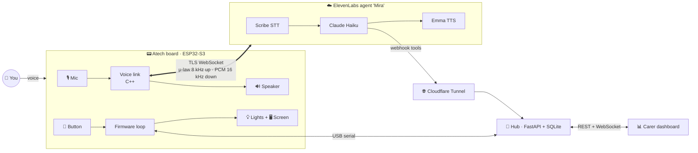

<p align="center">
  
</p>

<p align="center">
  <a href="https://atech.dev"></a>
  
  
  
  <br>
  
  
  
  
  
</p>

<p align="center">
  <b>Say "Hey Mira" and a small box on your table answers. In a warm voice, in one or two sentences.</b><br>
  <sub>Built in one hackathon day on an <a href="https://atech.dev">Atech</a> board.</sub>
</p>

---

## ✨ What I built

I built **Mira**, a voice-first AI companion for people who live alone, especially older people.
She lives in a palm-sized device with a mic, a speaker, a screen, a button and four lights.

You don't open an app. You just talk to her.

- 🗣️ **She talks with you** in a natural voice, in short, simple sentences.
- 💊 **She reminds you of your medicine.** The lights go red and the screen says what to take. You press the button, and it's logged.
- 💗 **She checks in on how you feel** and saves your mood, so a carer can see a trend instead of a guess.
- ✉️ **She does things for you**, like sending a text: *"Mira, send a text to Gustav saying I'll be home at six."*
- 🌡️ **She knows the room**: temperature and humidity from a sensor in the device.
- 🔵 **You can see she's there.** A light circles while she's connected.

Under the hood it's an **edge AI device with real-time two-way audio streaming, agentic tool-calling, and a full-stack backend**: embedded C++ on the device, a Python API on the laptop, and a cloud voice agent connecting the two.

## 🎬 The demo in 30 seconds

| You do | Mira does |
|---|---|
| *"Hey Mira, how are you?"* | Answers warmly, then asks how *you* feel, and logs your mood |
| It's 20:00 | Lights turn red, a chime plays, the screen shows **"Take 2 Keytruda pills"** |
| Press the button | Lights go green, *"Medicine taken. Well done!"*, dose logged |
| *"Mira, did I take my medicine?"* | Checks the log and tells you |
| *"Mira, send a text to Gustav saying I'm running late"* | *"Alright, I sent the message to Gustav."* and the screen confirms |
| *"Mira, it feels cold in here"* | Reads the room sensor and tells you the temperature |
| Press the button any other time | Ports 1 and 2 glow pink, like a little lamp |

## 🧠 How it works



1. **The device does the voice loop itself.** Its mic streams straight to the ElevenLabs agent over a secure WebSocket, and Mira's answer streams back to its speaker. There's no app or phone in between.
2. **The agent thinks and acts.** ElevenLabs turns speech into text, Claude Haiku decides what to say and which tool to call, and Emma's voice speaks the answer.
3. **Tools land on my hub.** When Mira logs a dose, saves a mood or sends a message, she calls a webhook. A Cloudflare tunnel carries it to `hub.py` on the laptop.
4. **The hub is the single source of truth.** It owns the USB link to the board, runs the medicine schedule, stores everything in SQLite, and pushes live updates to a dashboard over WebSockets.

## 🛠️ Tech stack

| Layer | What I used |
|---|---|
| Hardware | [Atech](https://atech.dev) 14-port board (ESP32-S3) · ICS-43434 I2S mic · MAX98357A I2S amp · ST7735 screen · 4× NeoPixel 3×3 grids · button · AHT20 sensor |
| Firmware | C++ (Arduino/ESP-IDF) generated and flashed with the **Atech Python SDK**, plus custom modules for voice, audio and screen |
| Voice AI | ElevenLabs Conversational AI · Scribe realtime STT · Claude Haiku 4.5 · Emma voice on `eleven_v4_turbo` |
| Backend | Python · FastAPI · SQLite · WebSockets · Atech SDK serial runtime |
| Networking | TLS WebSockets from the device · Cloudflare quick tunnel for the agent's webhooks |

## ⚡ Engineering highlights

The hardest part was making real-time voice fit on a microcontroller with **~130 KB of usable RAM**, where one TLS connection alone needs ~47 KB. Every fix below came from a measured failure:

- 🔊 **Mic too quiet to transcribe.** Speech came through at −60 dBFS. I kept all 24 bits from the MEMS mic and added ×16 digital gain.
- 🧩 **Agent audio frames bigger than the WebSocket library allows.** I vendored the library, raised the frame limit to 48 KB, and **reserve one frame buffer at boot** so a fragmented heap can't break a reply mid-sentence.
- 📉 **The upload choked a phone hotspot.** 16 kHz PCM stalled the device for up to 12 s at a time, so I switched the mic to **8 kHz μ-law: 4× less upload**, with no loss in recognition.
- 🎧 **Mira interrupted herself.** The playback logic mistook its own backpressure for "reply finished" and reopened the mic, so she heard her own voice. I fixed the timing and added a short echo mute.
- ♻️ **Self-healing.** A watchdog reboots the device if the main loop hangs, and a failed reconnect reboots into a clean heap. The device is back with Mira in about 10 s, and nobody has to touch it.
- 🖥️ **Screen buffer vs. TLS.** I replaced a 25 KB colour framebuffer with a **1.6 KB 1-bit canvas** that's pushed in bands. The screen stays flicker-free.

The details are in [docs/ARCHITECTURE.md](docs/ARCHITECTURE.md).

## 🧰 Build your own

### You need
- An **Atech** 14-port board with: 4× NeoPixel grid (ports 1-4), microphone (5-6), button (7), ST7735 screen (9-10), AHT20 sensor (11), speaker (13-14)
- A Mac or Linux laptop with **Python 3.10+**, and a 2.4 GHz WiFi network
- An **ElevenLabs** account

### 1. Install
```bash
git clone https://github.com/poolmoot/mira-ai-companion.git
cd mira-ai-companion
pip install atech fastapi "uvicorn[standard]"
```

### 2. Add your WiFi and agent
```bash
cp firmware/my_modules/microphone/voice_secrets.example.h firmware/my_modules/microphone/voice_secrets.h
# edit it: WiFi name + password, and your ElevenLabs agent ID (step 4)
```

### 3. Start the hub and the tunnel
```bash
./start.sh            # prints a public https://….trycloudflare.com URL
```

### 4. Create the agent
Follow [elevenlabs/README.md](elevenlabs/README.md): paste the prompt, add the six webhook tools with your tunnel URL, and pick the voice and audio settings.

### 5. Flash the board
```bash
cd firmware
atech validate . && atech upload .
```
The first build downloads the ESP32 toolchain (~2.4 GB, once). When the light on port 4 starts circling, say **"Hey Mira."**

> No board yet? Run `python3 hub/hub.py --fake` to get the full API without hardware, and build the dashboard against it.

## 📊 Build a dashboard on top

The hub exposes a REST API plus a live WebSocket feed: medicine log, mood trend, messages, room climate and device state. [docs/DASHBOARD_BRIEF.md](docs/DASHBOARD_BRIEF.md) is a ready-to-paste brief for a coding agent, and [docs/openapi.json](docs/openapi.json) is the full schema.

## 🗂️ Repo map

```
├── firmware/              Atech project: project.yaml + custom C++ modules
│   └── my_modules/
│       ├── microphone/    voice link to ElevenLabs, audio pipeline, μ-law, watchdog-friendly
│       ├── speaker/       I2S speaker driver
│       └── st7735_tft/    screen driver with a 1-bit canvas
├── hub/                   FastAPI hub: board bridge, schedule, SQLite, agent tools, live API
├── elevenlabs/            Mira's prompt, tool definitions and voice settings
├── docs/                  architecture, API schema, dashboard brief
└── start.sh               one command: hub + public tunnel
```

## 🚀 What's next

- 📱 Real SMS through Twilio instead of the demo message log
- 👨‍👩‍👧 A family app that gets a nudge when mood stays low or a dose is missed
- 🎙️ On-device wake word, so audio only leaves the house after "Hey Mira"
- 🔋 Battery power and a 3D-printed enclosure

## 🙏 Credits

- [**Atech**](https://atech.dev): the modular board and Python SDK that made going from idea to working hardware in a day possible
- [**ElevenLabs**](https://elevenlabs.io): Conversational AI, speech-to-text and the Emma voice
- [**Anthropic Claude**](https://www.anthropic.com): the model behind Mira's replies
- [arduinoWebSockets](https://github.com/Links2004/arduinoWebSockets) by Markus Sattler (LGPL-2.1, vendored and modified)

> ⚠️ Mira is a hackathon prototype, not a medical device. Don't rely on it for real medication management.

<p align="center"><sub>MIT licensed · Made with 💜 by Yusuf, built with <a href="https://atech.dev">Atech</a></sub></p>
